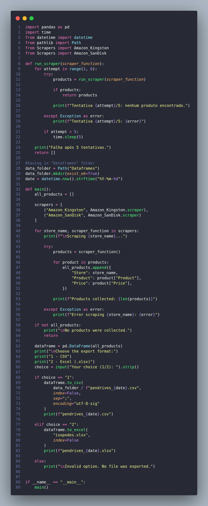

# 🐸 🐍 ⚙️

Este "web scraper" tem como objetivo coletar anúncios de pendrives na Amazon, coletando os anúncios e transformando-os em uma planilha. O sistema coleta o título e o preço dos anúncios e permite a escolha entre salvar como .csv ou .xlsx, revisar os sites se houver algum anúncio interessante na planilha :)

# ⚙️ Instalação
### Pré-requisitos
* Python 3.12.3
* Git
* pip (pip3 no linux)
* Bibliotecas em 'requirements.txt'

**Como instalar**
1. Clone o repositório:
 ```bash
git clone https://github.com/pythonbyfrogs/Scraper-Pendrives-Amazon
cd "Scraper Pendrives Amazon"
```
2. Instale as dependências:
```bash
python3 -m pip install -r requirements.txt
```
Windows:
```bash
py -m pip install -r requirements.txt
```
3. Rode o scraper:
```bash
python3 main.py
```
Windows:
```bash
py main.py
```
# 👀 Tech stack
### Estrutura
Os scrapers estão na pasta 'Scrapers'. O ideal é usar o scraper individual se quiser verificar os anúncios e a disponibilidade dos pendrives. Entretanto, os scrapers individuais NÃO GERAM PLANILHAS. Se você quiser uma planilha geral, use 'main.py' através do terminal. Sinta-se à vontade para adaptar os códigos às suas necessidades.
### Sites
Os sites monitorados são:
* https://www.amazon.com.br/s?k=pen+drive+Kingston
* https://www.amazon.com.br/s?k=pen+drive+sandisk

### Tome água. 🥤
