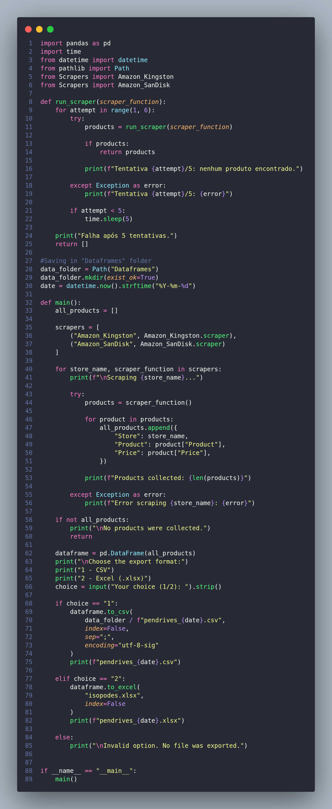

# 🐸 🐍 ⚙️

This "web scraper" aims to collect ads from pendrives in Amazon, collecting the ads and turning them into a spreadsheet. The system collects the title and price of ads, then allows the choice between saving as .csv or .xlsx, review the sites if there is any interesting ad in the spreadsheet :)

# ⚙️ Installation
### Prerequisites
* Python 3.12.3
* Git
* pip (pip3 in linux)
* Libraries in 'requirements.txt'

**How to do**
1. Clone the repository:
 ```bash
git clone https://github.com/pythonbyfrogs/Scraper-Pendrives-Amazon
cd "Scraper-Pendrives-Amazon"
```
2. Install dependencies:
```bash
python3 -m pip install -r requirements.txt
```
Windows:
```bash
py -m pip install -r requirements.txt
```
3. Running the scraper:
```bash
python3 main.py
```
Windows:
```bash
py main.py
```
# 👀 Tech stack
### Estructure
The scrapers are in the 'Scrapers' folder. You can only use the individual scraper if you want to check the ads and availability of pendrives. However, the individual scrapers DO NOT GENERATE SPREADSHEETS. If you want a general spreadsheet, use 'main.py' via the terminal. Feel free to adapt the codes to your needs.
### Sites
The monitored sites are:
* https://www.amazon.com.br/s?k=pen+drive+Kingston
* https://www.amazon.com.br/s?k=pen+drive+sandisk

### Drink more water. 🥤

